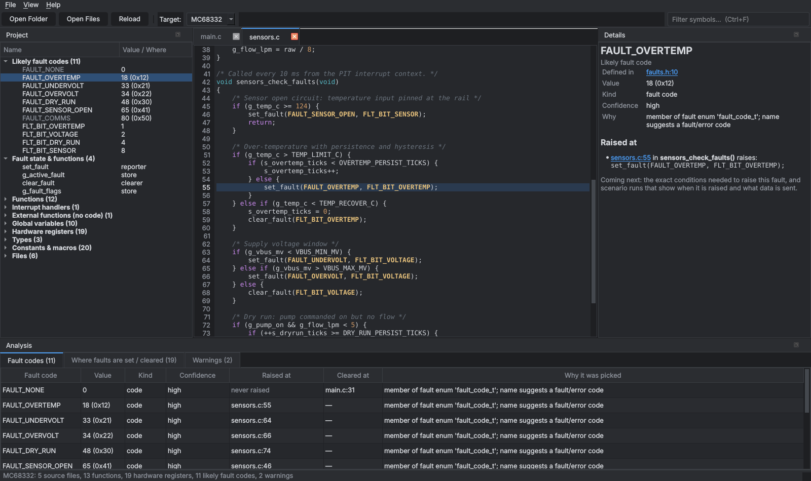

# Source Tracer

A desktop tool (Qt, dark mode) for reading microcontroller firmware without
being a software engineer. Load C / C++ source and Source Tracer shows:

- its functions, interrupt handlers, variables, types and constants;
- the **hardware registers** it uses, matched to the chip's register map, and
  which ones **send data** (e.g. the MC68332 SCI data register);
- **likely fault codes**, where each one is raised, cleared or checked, and
  the variables and functions that hold fault state.



Coming next: running the code with chosen inputs to see which faults are
raised and what data is sent in each scenario. See [PLAN.md](PLAN.md).

## Quick start

```bash
python -m venv .venv
source .venv/bin/activate          # Windows: .venv\Scripts\activate
pip install -e ".[dev]"

source-tracer examples/mc68332_pump_controller   # or: python -m source_tracer <folder or files>
```

Then use **Open Folder…** to load your own firmware. Pick the chip under
**Target** (`MC68332`, or `Generic` for anything else).

## Using it

| Panel | What it shows |
|---|---|
| **Project** (left) | Fault codes, fault state and functions, functions, ISRs, external (assembly/library) functions, globals, hardware registers by module, types, constants, files. Type in the filter box to search. |
| **Source** (centre) | The code, with registers in red and fault codes in yellow. Clicking anything jumps here. |
| **Details** (right) | A plain-English description of the selected item: what it is, its value, where it is used. Links jump to the code. |
| **Analysis** (bottom) | *Fault codes* table, *Where faults are set / cleared* (every line that raises, clears or checks a fault), and *Warnings* (code the tool couldn't fully understand, missing functions, unknown registers). |

## Adding a microcontroller

Chip knowledge lives in YAML profiles in `source_tracer/profiles/`. Copy
`mc68332.yaml` and edit:
- endianness and type sizes;
- compiler-specific keywords to ignore;
- the register map, where each register has a role:
  - `tx` — writes are transmitted data;
  - `rx` — reads come from scenario input;
  - `status` — reads return a default "ready" value;
  - `plain` — no special behaviour.

No code changes are needed.

## Development

```bash
pytest            # unit + GUI smoke tests (GUI runs headless with QT_QPA_PLATFORM=offscreen)
```

Layout: `source_tracer/frontend` (parsing, symbols), `analysis` (fault
detection), `gui` (Qt), `profiles` (chip definitions), `examples` (sample
firmware used by tests).
